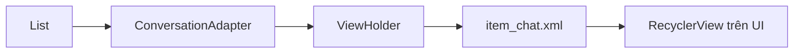

# Tài liệu Tính năng Danh sách Chat (Conversation List)

Tài liệu này tóm tắt cấu trúc và luồng hoạt động của tính năng hiển thị danh sách các cuộc hội thoại trong ứng dụng **EduShare**.

---

## 1. Cấu trúc các tệp tin chính

### 📂 Model: `Conversation.java`
- **Mục đích:** Là lớp đối tượng chứa dữ liệu (POJO). Nó đại diện cho một "dòng" trong danh sách chat, bao gồm thông tin người chat cùng (`partnerName`, `partnerAvatarUrl`) và nội dung tin nhắn cuối cùng.
- **Ánh xạ:** Được thiết kế tương ứng với kết quả truy vấn từ bảng `conversations` và `users` trong cơ sở dữ liệu.

### 📂 Adapter: `ConversationAdapter.java`
- **Mục đích:** Đóng vai trò là "cầu nối" giữa dữ liệu và giao diện.
- **Nhiệm vụ:**
    - Khởi tạo giao diện cho từng mục tin nhắn (`item_chat.xml`).
    - Gán dữ liệu từ đối tượng `Conversation` vào các View tương ứng.
    - Sử dụng thư viện **Glide** để xử lý tải ảnh đại diện mượt mà.

### 📂 Activity: `ConversationActivity.java`
- **Mục đích:** Màn hình chính hiển thị danh sách.
- **Nhiệm vụ:**
    - Ánh xạ `RecyclerView` từ layout `chat_list.xml`.
    - Quản lý danh sách dữ liệu (hiện tại là Dummy Data).
    - Kết nối danh sách với Adapter để hiển thị lên màn hình.

---

## 2. Luồng hoạt động của dữ liệu (Data Flow)

Luồng đi của dữ liệu từ khi khởi tạo đến khi hiển thị trên UI:

1.  **Data Source (Model):** Danh sách `List<Conversation>` được tạo ra (trong thực tế sẽ lấy từ API/Local DB).
2.  **Controller (Activity):** `ConversationActivity` khởi tạo `ConversationAdapter` và truyền danh sách dữ liệu này vào thông qua Constructor.
3.  **Binding (Adapter):** 
    - `onCreateViewHolder`: Nạp layout `item_chat.xml`.
    - `onBindViewHolder`: Lấy từng đối tượng `Conversation` theo vị trí (`position`) và gán giá trị vào `TextView`, `ImageView`.
4.  **UI (RecyclerView):** Hiển thị các item đã được "đổ" dữ liệu lên màn hình người dùng.

---

## 3. Kế hoạch Commit Git

Để quản lý mã nguồn tốt hơn, hãy commit theo các bước sau:

*   **Bước 1: UI & Resources**
    - Nội dung: Thêm các tệp XML layout (`chat_list.xml`, `item_chat.xml`), drawables (`bg_badge.xml`), và icon.
    - Message: `feat(chat): design chat list and message item UI`

*   **Bước 2: Logic Model & Adapter**
    - Nội dung: Tạo class `Conversation` và `ConversationAdapter`. Cài đặt thư viện Glide.
    - Message: `feat(chat): implement Conversation model and RecyclerView adapter`

*   **Bước 3: Activity & Dummy Data**
    - Nội dung: Hoàn thiện `ConversationActivity`, gắn Adapter và đổ dữ liệu mẫu để kiểm tra.
    - Message: `feat(chat): connect adapter to activity and display dummy data`

---

## 4. Danh sách việc cần làm tiếp theo (Todo)

- [ ] **Kết nối API:** Viết `ChatApi` sử dụng Retrofit để lấy dữ liệu thực từ MySQL thay vì dùng Dummy Data.
- [ ] **Xử lý thời gian:** Viết helper để format `updated_at` từ Database (ví dụ: `2023-10-27 10:00:00`) sang dạng thân thiện như `2m ago`.
- [ ] **Tính năng Click:** Bắt sự kiện click vào một item để chuyển sang màn hình nhắn tin chi tiết (`ChatDetailActivity`).
- [ ] **Realtime (Option):** Tích hợp Firebase hoặc WebSockets để cập nhật tin nhắn mới ngay lập tức mà không cần load lại trang.

---
*Tài liệu được khởi tạo tự động bởi Gemini trợ lý lập trình.*
